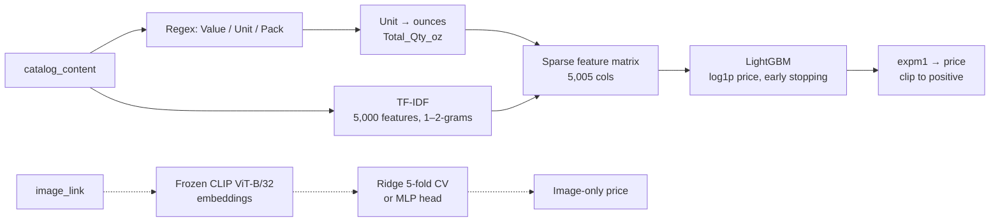

# Amazon ML Challenge 2025: Smart Product Pricing

> Predicting e-commerce product prices from catalogue text (and, experimentally, product images) with TF-IDF + LightGBM and frozen CLIP embeddings. Team SentinelX entry.


-lightgrey)

## Contents

- [Overview](#overview)
- [Highlights](#highlights)
- [Approach](#approach)
- [Results](#results)
- [Project structure](#project-structure)
- [Getting started](#getting-started)
- [Data](#data)
- [Team](#team)
- [License](#license)

## Overview

**Problem.** The Amazon ML Challenge 2025 asked for a model that predicts a product's price from its catalogue entry: a free-text `catalog_content` field (title, description, item-pack quantity) and an image URL. 75 k labelled training products, 75 k test products, scored by **SMAPE** (lower is better, 0–200 %). External price lookup was forbidden, and any model had to be MIT/Apache-2.0 licensed and ≤ 8 B parameters.

**Approach.** Parse the structured bits hidden in the text (`Value`, `Unit`, `Pack of N`), normalise every quantity to ounces, add 5,000 TF-IDF features, and regress **log-price** with LightGBM. In parallel, try image-only models on frozen CLIP ViT-B/32 embeddings, and an image + text variant with ResNet-50 features.

**Result.** The text model reached a **validation SMAPE of 51.73 %** (20 % hold-out) and was the approach submitted with the team's write-up. Image-based variants were explored but no validated score for them is recorded in this repo.

## Highlights

- **Regex feature extraction** of value / unit / pack size from unstructured catalogue text, with unit conversion (g, kg, lb, ml, fl oz → oz) and a `Total_Qty_oz = value × pack` feature.
- **Log-target regression** with LightGBM on a sparse 5,005-column matrix (TF-IDF 1–2-grams + 5 numeric features), early stopping on a 20 % validation split.
- **Image track on a 4 GB GPU**: frozen CLIP ViT-B/32 embeddings + 5-fold Ridge, or a frozen backbone with a small MLP head (AMP).
- Saved artifacts (booster, vectorizer, unit mapping, config) plus an inference helper so test predictions can be regenerated without retraining.

## Approach



Dashed path = experimental image track (`v2-lightgbm-clip/`).

<details>
<summary><b>LightGBM configuration</b></summary>

| Parameter | Value |
|---|---|
| Objective / metric | `regression` (L2) on `log1p(price)` |
| `num_leaves` | 64 |
| `learning_rate` | 0.05 |
| Early stopping | 50 rounds on 20 % hold-out (`random_state=42`) |
| Best iteration | 1,019 (Colab run) / 1,061 (local run) |
| Final model | retrained on all 75 k rows for the best iteration count |
</details>

## Results

All numbers are printed in the committed notebooks.

| Model | Notebook | Validation | SMAPE |
|---|---|---|---|
| TF-IDF + numeric → LightGBM, log target (**submitted**) | `v2-lightgbm-clip/notebooks/lightgbm_tfidf_colab.ipynb` | 20 % hold-out | **51.73 %** (train L2 0.202, val L2 0.467) |
| Same pipeline, local re-run with saved artifacts | `v1-text-lightgbm/notebooks/lightgbm_tfidf.ipynb` | 20 % hold-out | 52.30 % |
| TF-IDF + Value/Pack/Unit → LightGBM, raw-price L1 objective (first baseline) | `v2-lightgbm-clip/notebooks/lightgbm_tfidf_colab.ipynb` | 20 % hold-out | 52.99 % |
| ResNet-50 image features + TF-IDF → LightGBM | `v1-text-lightgbm/notebooks/multimodal_resnet50_lightgbm.ipynb` | – | not recorded (image feature extraction finished in 2 h 43 min, then feature stacking failed with a dtype error) |
| Frozen CLIP ViT-B/32 → Ridge / MLP head | `v2-lightgbm-clip/*.py` | 5-fold CV | not recorded (predictions only) |

Training prices range from $0.13 to $2,796 (median $14.00), which is why the log target matters: moving from a raw-price L1 objective to log-price regression (plus the ounce-normalised quantity features) took validation SMAPE from 52.99 % to 51.73 %. Public/final leaderboard positions are not recorded here.

## Project structure

```text
Amazon-ML-Challenge/
├── docs/
│   ├── problem_statement.md          # challenge brief as provided by the organisers
│   └── approach_document.md          # 1-page methodology submitted by the team
├── v1-text-lightgbm/
│   ├── notebooks/
│   │   ├── lightgbm_tfidf.ipynb                  # text model, saves artifacts/
│   │   └── multimodal_resnet50_lightgbm.ipynb    # ResNet-50 + text attempt (did not complete)
│   ├── artifacts/                    # lgbm_model.txt, tfidf_vectorizer.pkl, unit_mapping.json, config.json, predictions.csv
│   ├── output/test_out.csv           # submission file (75,000 rows) from the 51.73 % model
│   ├── src/
│   │   ├── utils.py                  # parallel image downloader
│   │   └── sample_predictor.py       # organisers' sample submission script (random baseline)
│   └── requirements.txt
├── v2-lightgbm-clip/
│   ├── notebooks/lightgbm_tfidf_colab.ipynb      # Colab notebook for the submitted model
│   ├── model/                        # booster from the Colab run
│   ├── image_clip_embed_cv.py        # CLIP embeddings + Ridge (5-fold CV)
│   ├── image_clip_head_finetune_fast.py          # frozen CLIP + MLP head
│   ├── attach_image_paths.py
│   ├── src/                          # io_images.py, smape.py
│   ├── output/test_out.csv           # CLIP-route predictions
│   ├── requirements.txt
│   └── README.md
├── LICENSE
└── README.md
```

## Getting started

```bash
git clone https://github.com/rupeshbharambe24/Amazon-ML-Challenge.git
cd Amazon-ML-Challenge
python -m venv .venv && source .venv/bin/activate
pip install -r v1-text-lightgbm/requirements.txt
```

Place the challenge files at `dataset/train.csv` and `dataset/test.csv` (repo root; git-ignored), then:

```bash
# text model: trains, evaluates SMAPE, saves artifacts and writes a submission
jupyter lab v1-text-lightgbm/notebooks/lightgbm_tfidf.ipynb

# optional: download product images for the image track
python v1-text-lightgbm/src/utils.py
```

For the CLIP image track see [`v2-lightgbm-clip/README.md`](v2-lightgbm-clip/README.md).

## Data

The challenge dataset is **not** included and should not be redistributed; it was provided to participants under the challenge terms. The repo contains only derived files: trained models, a fitted TF-IDF vectorizer, and test-set predictions keyed by `sample_id`. The notebooks also show the first few training rows in their saved outputs.

Note: `v2-lightgbm-clip/model/tfidf_vectorizer.pkl` is only 457 bytes and appears to be an unfitted vectorizer; use `v1-text-lightgbm/artifacts/` for inference.

## Team

Team **SentinelX**: Rupesh Bharambe, Nilesh Kale, Anjali Maske.

## License

Code is released under the [MIT License](LICENSE). The challenge brief in `docs/problem_statement.md` and the dataset belong to the challenge organisers.
